<p align="center">
  
</p>

<h3 align="center">Je eerste huis kopen? Weet eindelijk wat je écht kan betalen. 🏡</h3>

<p align="center">
  <a href="https://loanarr.sennedewever.be"><b>👉 Probeer Loanarr gratis op loanarr.sennedewever.be</b></a>
</p>

<p align="center">
  Gratis · zonder account · zonder e-mailadres · je gegevens blijven in je browser
</p>

<p align="center">
  <a href="https://loanarr.sennedewever.be">
    
  </a>
  <br>
  <sub>Loanarr in 35 seconden: van je situatie tot je aflossingstabel.</sub>
</p>

---

## Ken je dat?

Je scrolt door Immoweb, ziet een droomwoning van € 340.000 en vraagt je af: *"Kan ik dat
eigenlijk wel betalen?"*

Dus je zoekt een online simulator. Die vraagt hoeveel je wil **lenen**. Maar dat is net wat je
niet weet! En dan blijkt het bedrag dat eruit komt ook nog eens zonder registratierechten,
zonder notariskosten en zonder kredietakte te zijn. Op de bank volgt de koude douche:
*"Ah, en dan nog € 20.000 aan kosten, hé."*

**Dat kan beter. Daarom is er Loanarr.**

## Maak kennis met Loanarr ✨

Loanarr draait de vraag om. Je vertelt wat je **verdient** en wat je **gespaard** hebt, en
Loanarr rekent uit hoeveel je woning mag kosten. Alles erin: de notaris, de registratierechten
van jouw gewest, de kosten van je lening en de rente die Belgische kopers vandaag écht betalen.

Geen giswerk meer. Je stapt het kantoor van je bank of makelaar binnen met een plan dat klopt
tot op de cent. 💪

### Zo werkt het, in drie stappen

| | |
|---|---|
| **1. Vertel wie je bent** | Alleen of met twee? Wat verdien je, wat staat er op je spaarrekening, krijg je hulp van je ouders? |
| **2. Kies je budget** | Loanarr stelt een *comfortabele* en een *maximale* maandlast voor. Jij kiest. |
| **3. Zie wat je kan kopen** | Je maximale aankoopprijs, het volledige financieel plan, en wat het je over 25 jaar echt kost. |

En dat allemaal live: verschuif een slider en alles rekent meteen opnieuw.

---

## Waarom je Loanarr gaat liefhebben ❤️

### 🎯 Een budget dat bij jóu past, niet bij de bank

Banken kijken vooral naar wat ze maximaal mogen lenen. Loanarr kijkt ook naar wat comfortabel
is. Je krijgt twee scenario's naast elkaar, en een buffer voor onverwachte kosten blijft
gewoon op je spaarrekening staan. Want een nieuwe ketel in je eerste winter? Die komt sneller
dan je denkt.

<p align="center">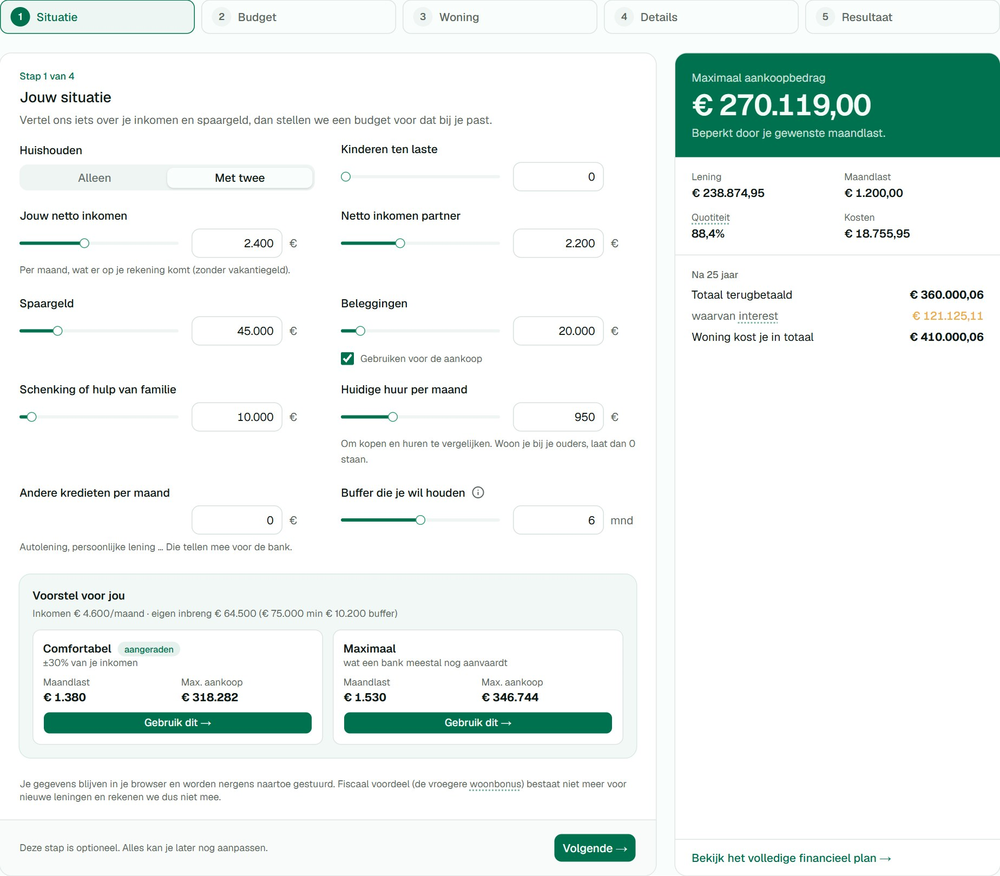</p>

### ⚡ Live resultaat terwijl je schuift

Iets meer eigen inbreng? Een jaartje langer lenen? Je ziet meteen wat het doet met je maximale
aankoopprijs, je lening en wat je in totaal terugbetaalt. Spelen met de cijfers was nog nooit
zo leuk (en zo leerrijk).

<p align="center">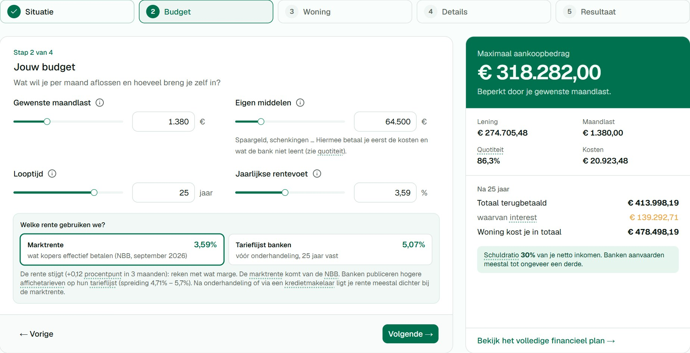</p>

### ✅ Ben je er klaar voor? Eerlijk antwoord.

Loanarr zegt het je recht in je gezicht, maar wel vriendelijk. 🙂 Volstaat je eigen inbreng?
Blijft je schuldratio onder een derde? Hou je genoeg leefgeld over? Groen, oranje of rood, met
uitleg over wat je kan doen.

<p align="center">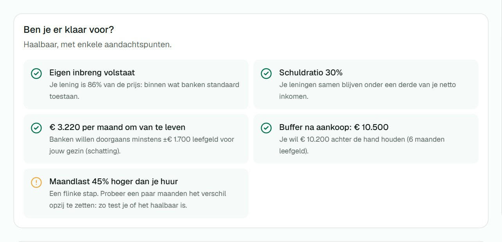</p>

### 💶 Wat het je echt kost (ook over 25 jaar)

Niet alleen de maandlast, maar het volledige plaatje: hoeveel je de bank uiteindelijk
terugbetaalt, hoeveel daarvan interest is, en wat je woning je in totaal kost. Even slikken,
maar beter nu dan later.

<p align="center">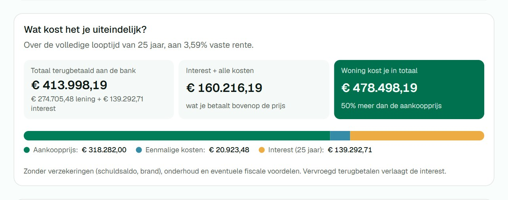</p>

### 🔑 Kopen of huren? Eindelijk een antwoord.

De eeuwige discussie op familiefeesten, nu met cijfers. Loanarr vergelijkt je vermogen bij
kopen met blijven huren en je eigen inbreng beleggen, over 10, 15 of 25 jaar. Inclusief het
*omslagpunt*: vanaf wanneer kopen de betere keuze wordt.

<p align="center">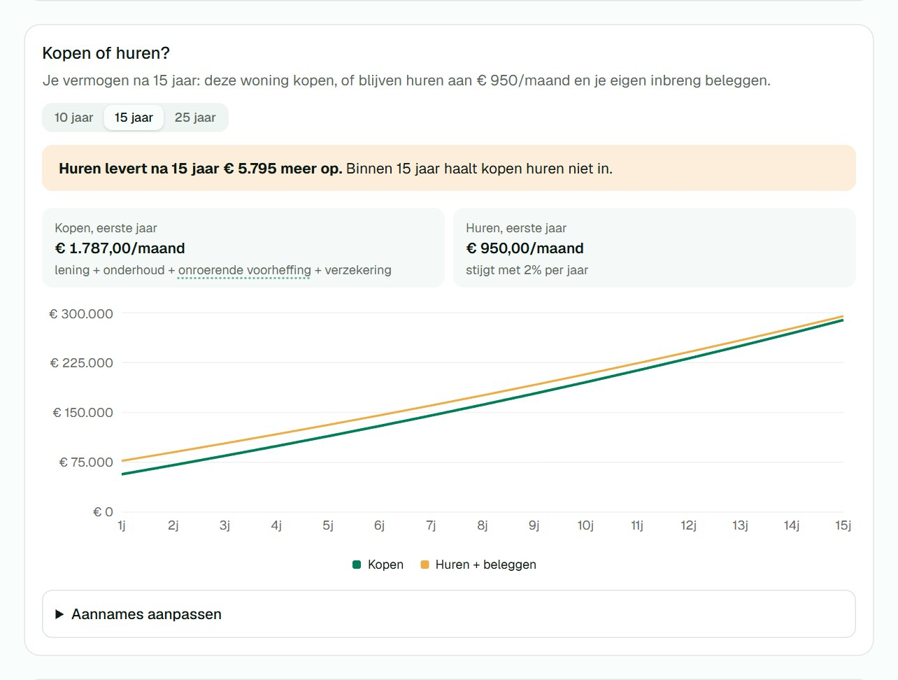</p>

### 🇧🇪 Gemaakt voor België, tot in het kleinste detail

Geen Nederlandse of Amerikaanse rekensom met een Belgisch sausje. Loanarr kent de regels:
registratierechten per gewest, het wettelijke notarisbarema, inschrijving of mandaat, de
Belgische manier om de maandrente te berekenen. Je krijgt een financieel plan zoals bij een
kredietmakelaar, en uitgaven en financiering kloppen tot op de cent.

<p align="center">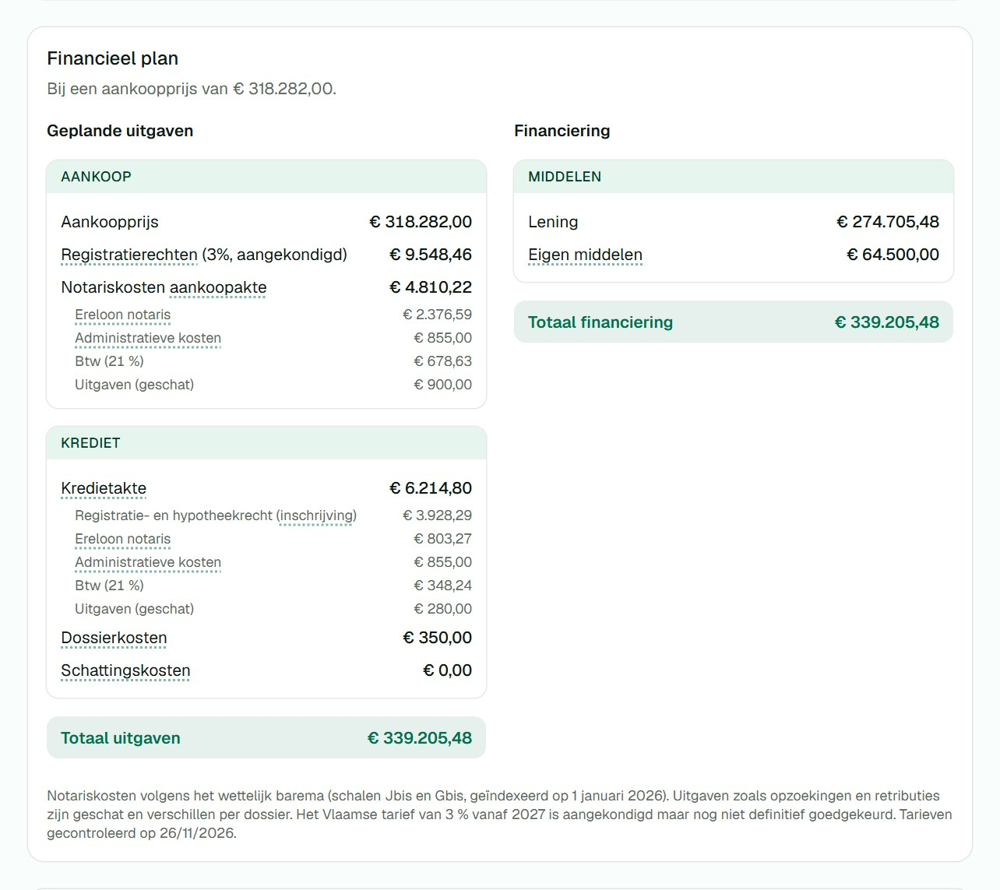</p>

### 🏦 Wat geven de banken vandaag?

Loanarr legt de tarieflijsten van Argenta, Belfius, Crelan, BNP Paribas Fortis en Elantis naast
elkaar en toont per bank wat dat voor jouw aankoopbudget betekent. Het verschil loopt al snel
op tot tienduizenden euro's. Handig om mee te nemen naar je volgende afspraak. 😉

<p align="center">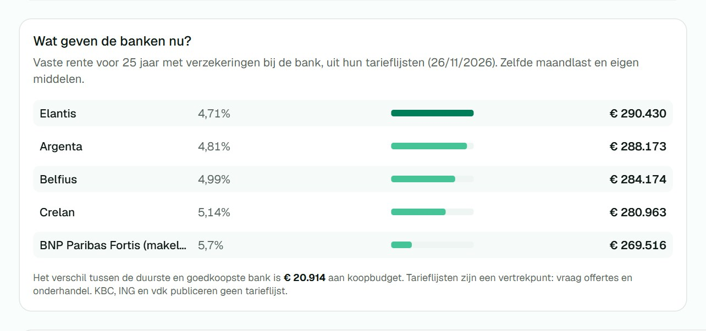</p>

### 📈 De rente van vandaag, live

Loanarr rekent standaard met de rente die Belgische kopers effectief betalen, rechtstreeks van
de Nationale Bank. Met een grafiek van twintig jaar zie je meteen of de rente stijgt of daalt.
Nieuwe cijfers verschijnen vanzelf.

<p align="center">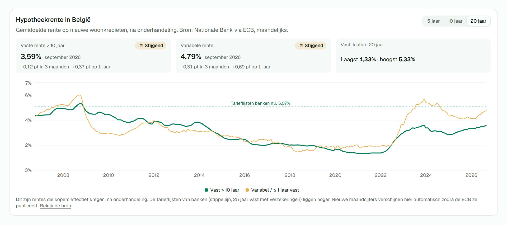</p>

### 🧠 Nooit meer "euh, wat is een quotiteit?"

Elk moeilijk woord heeft een stippellijn: beweeg erover en je krijgt uitleg in gewone taal.
Quotiteit, mandaat, JKP, schuldratio, omslagpunt... Na Loanarr praat je mee met je bankier.

### 🎨 Mooi op elk scherm

Werkt even vlot op je gsm als op je laptop. Licht of donker, twaalf kleurthema's, of kies
gewoon je eigen kleur.

<p align="center">
  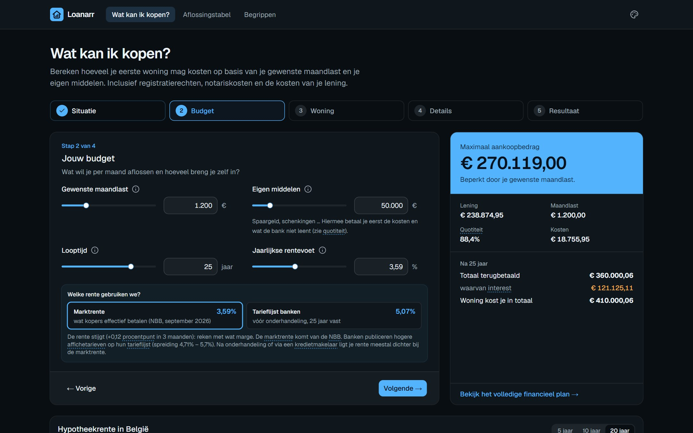
  &nbsp;
  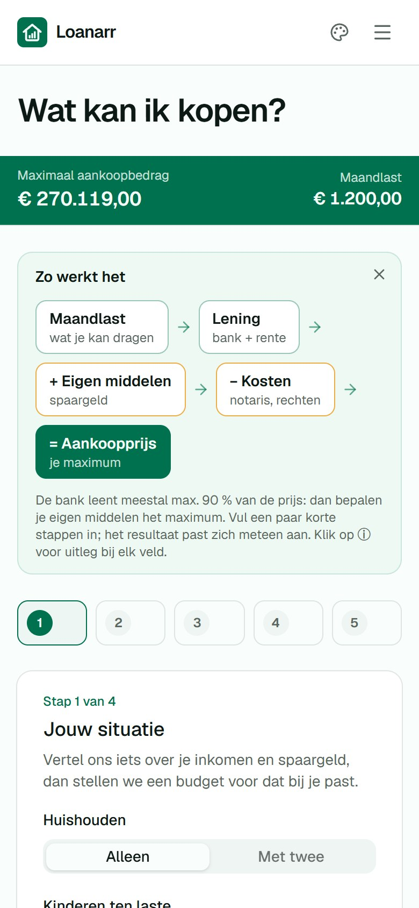
</p>

---

## Vaak gestelde vragen 🙋

**Is Loanarr gratis?**
Ja. Geen account, geen e-mailadres, geen kleine lettertjes.

**Wat gebeurt er met mijn gegevens?**
Niets. Alles wat je invult blijft in je eigen browser en wordt nergens naartoe gestuurd.

**Hoe juist zijn de cijfers?**
Loanarr rekent met de officiële regels: het wettelijke notarisbarema, de registratierechten van
elk gewest en de rente van de Nationale Bank. Bij elk getal staat waar het vandaan komt, en de
footer toont wanneer elke bron voor het laatst is bijgewerkt.

**Vervangt dit mijn bank of makelaar?**
Nee, en dat wil het ook niet. Loanarr is je voorbereiding: je weet wat haalbaar is, welke kosten
eraan komen en welke vragen je moet stellen. Je bank beslist uiteindelijk over je lening.

**Werkt het voor heel België?**
Ja: Vlaanderen, Wallonië en Brussel, voor de aankoop van je enige eigen woning.

<p align="center">
  <a href="https://loanarr.sennedewever.be"><b>🏡 Klaar om te ontdekken wat je kan kopen? Start op loanarr.sennedewever.be</b></a>
</p>

> **Disclaimer.** Loanarr is een simulatie en geen kredietaanbod. Je bank beslist op basis van
> je volledige situatie. Verzekeringen en het jaarlijks kostenpercentage (JKP) zijn niet
> meegerekend. De woonbonus of een ander fiscaal voordeel bestaat niet meer voor nieuwe leningen
> en rekent Loanarr dus niet mee.

---

## Onder de motorkap 🔧

<details>
<summary><b>Hoe Loanarr rekent</b></summary>

| | Hoe |
|---|---|
| **Maandrente** | De gelijkwaardige maandrente `(1 + jaarrente)^(1/12) − 1`, zoals Boek VII van het Wetboek Economisch Recht voorschrijft (niet jaarrente / 12). |
| **Aflossingswijze** | Vaste mensualiteiten of vaste kapitaalaflossing. Alle bedragen worden op de cent afgerond; de laatste betaling vangt de afronding op. |
| **Registratierechten** | Vlaanderen 2 % (3 % aangekondigd vanaf 2027, nog niet definitief), Wallonië 3 %, Brussel 12,5 % met vrijstelling op de eerste € 200.000 (tot € 600.000). |
| **Notaris** | Wettelijke barema's **Jbis** (aankoop enige eigen woning) en **Gbis** (krediet), geïndexeerd op 1 januari 2026, plus administratiekosten en btw. |
| **Hypotheek** | 1 % registratierecht + 0,3 % hypotheekrecht op het ingeschreven deel; een mandaat vermijdt die. |
| **Rente** | Standaard de live marktrente van de NBB (vast > 10 jaar). Met één klik het gemiddelde van de tarieflijsten van Argenta, Belfius, Crelan, BNP Paribas Fortis en Elantis. |
| **Maximum** | Beperkt door je maandbudget én door de quotiteit (standaard 90 %), wat het eerst bereikt wordt. |

Het notarisbarema reproduceert de gepubliceerde referentiebedragen voor 2026 exact, en de kosten
van de kredietakte liggen binnen € 30 van een echte simulatie van een Belgische kredietmakelaar.

**Bronnen:** [ECB Data Portal](https://data.ecb.europa.eu/data/datasets/MIR) (MFI-rentestatistiek
voor België, verzameld door de NBB), het tariefbesluit op [notaris.be](https://www.notaris.be),
[vlaanderen.be](https://www.vlaanderen.be), [wallonie.be](https://www.wallonie.be),
[be.brussels](https://be.brussels) en de tarieflijsten van de banken (met datum in
[`rates.ts`](src/lib/sim/rates.ts)).

</details>

<details>
<summary><b>Voor ontwikkelaars</b></summary>

### Snel starten

Je hebt [Bun](https://bun.sh) 1.3+ en Node.js 20+ nodig.

```bash
bun install
bun dev          # http://localhost:3000
```

| Commando | Wat het doet |
|---|---|
| `bun dev` | Dev-server starten |
| `bun run build` | Productiebuild |
| `bun run test` | Unittests (Vitest); niet `bun test`, dat is Buns eigen testrunner |
| `bun run lint` / `bun run format` | Biome: controleren / formatteren |
| `bun run typecheck` | TypeScript-controle |
| `bun run rates:snapshot` | Reservekopie van de ECB-rentedata vernieuwen |

> Pikt de dev-server een wijziging aan `globals.css` niet op (gebeurt soms op Windows), herstart
> dan `bun dev`.

### Stack

Next.js 16 (App Router, Cache Components) · TypeScript · Bun · Tailwind CSS v4 ·
[shadcn/ui](https://ui.shadcn.com) op Base UI · Recharts · Zustand · Zod · decimal.js · Vitest ·
Biome · Vercel.

### Structuur

```
src/
  app/                 routes: /, /aflossing, /begrippen
  components/sim/      de wizard, kaarten, info-uitleg
  components/market/   de rentegrafiek
  lib/sim/             rekenmotor: puur TypeScript, geen React (lening, kosten, budget, kopen vs huren)
  lib/market/          live ECB-data, trend en reservekopie
  lib/glossary.ts      de begrippenlijst
  stores/              Zustand-stores
docs/                  README-banner en screenshots
```

**Regel:** `src/lib/sim/` blijft pure TypeScript zonder React of browser-API's. Zo is de rekenmotor
makkelijk te testen en overal herbruikbaar.

### Onderhoud

- **Banktarieven** veranderen om de paar weken: werk de tabel en `RATES_CHECKED_ON` bij in
  [`rates.ts`](src/lib/sim/rates.ts). KBC, ING en vdk publiceren geen tarieflijst.
- **Notaris- en registratietarieven** staan in [`tariffs.ts`](src/lib/sim/tariffs.ts), met bron en
  `TARIFFS_CHECKED_ON`. Controleer ze minstens elk jaar in januari (indexering).
- **Leefgeld-minimums** in [`situation.ts`](src/lib/sim/situation.ts) zijn schattingen; banken
  hanteren eigen normen.
- **Nog niet gemodelleerd:** variabele rentes en hun wettelijke plafonds, het JKP, de Vlaamse
  vermindering voor een bescheiden woning, nieuwbouw (btw in plaats van registratierechten) en
  verzekeringen.
- **Na te kijken:** het eigen voorbeeld van Elantis (€ 200.000, volledige inschrijving) vermeldt
  € 4.590,89 hypotheekkosten, ongeveer € 435 onder onze schatting.

### Thema's

Alle kleuren in [`globals.css`](src/app/globals.css) volgen uit drie variabelen: `--h` (tint),
`--s` (verzadiging) en `--ah` (contrasttint voor interest en kosten). Een nieuw thema is een
blok `:root[data-palette="…"]` plus een regel in `palettes` in [`theme.ts`](src/lib/theme.ts).

### Deployen

Elke push naar `main` gaat via Vercel live op
[loanarr.sennedewever.be](https://loanarr.sennedewever.be); andere branches krijgen een eigen
voorbeeld-URL. Er zijn geen omgevingsvariabelen nodig. Logo-varianten staan in
[`public/logos/`](public/logos/).

</details>
